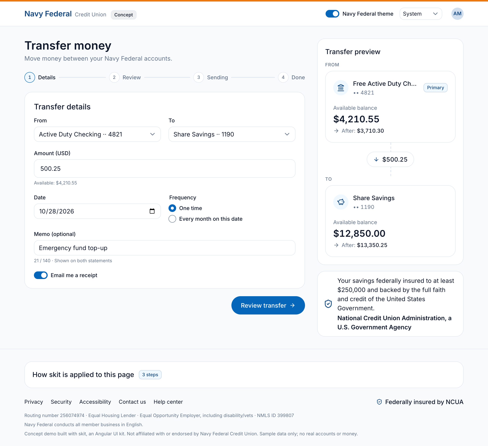
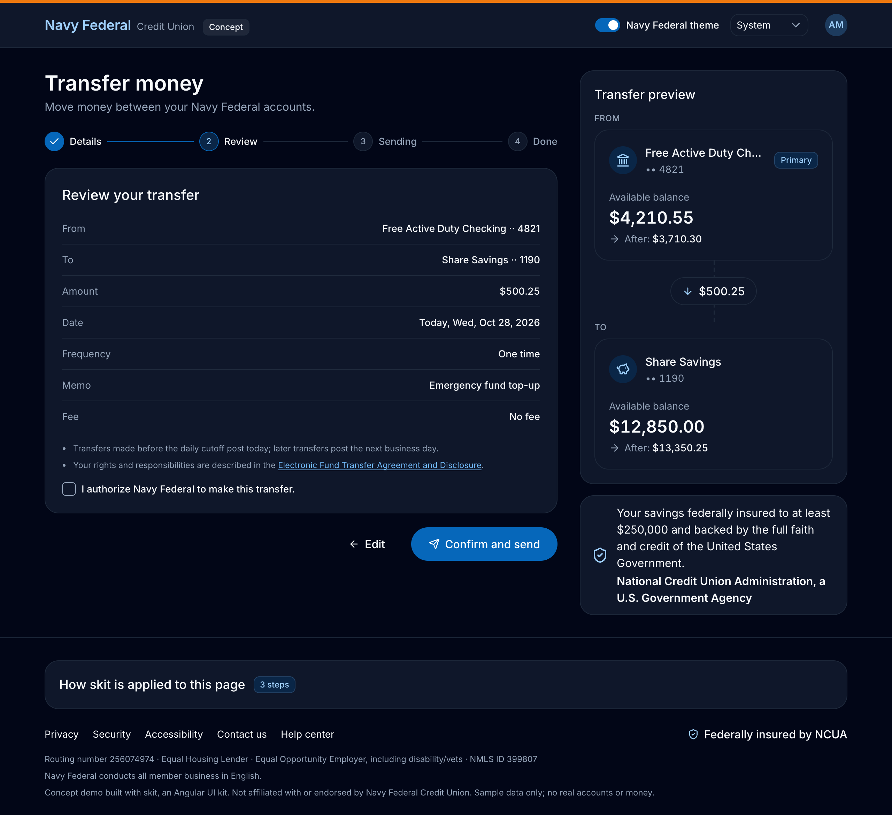
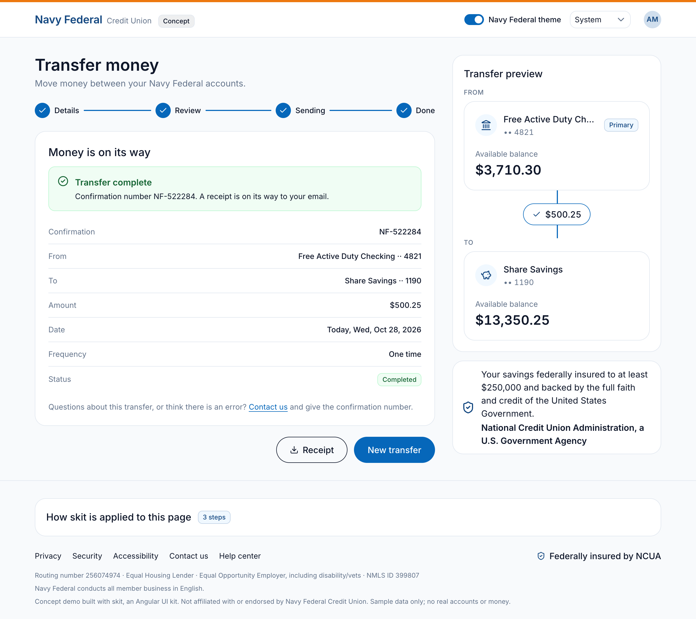
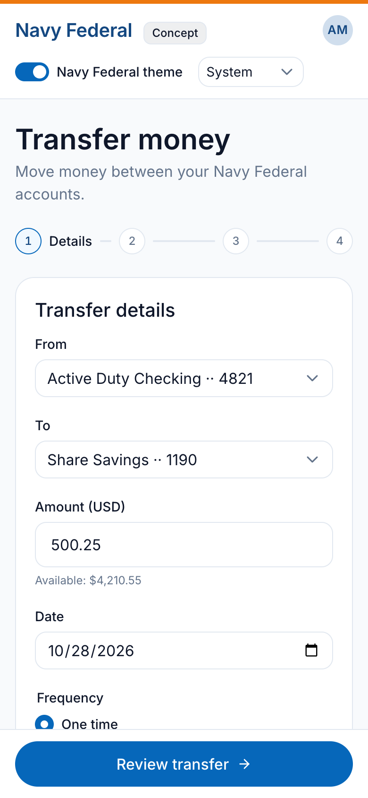
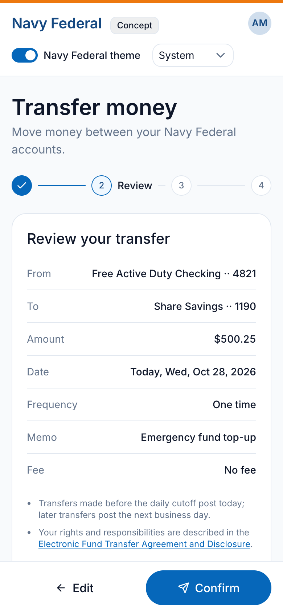
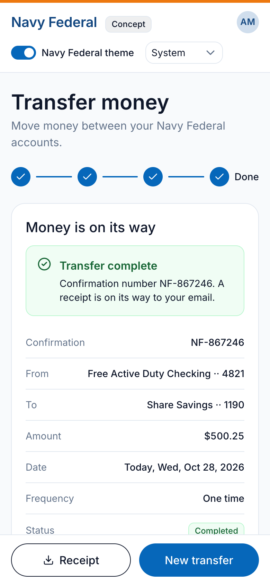

# skit

An Angular UI kit for banking and financial apps. It is built with atomic design, accessible by default,
and made to slot into existing apps one page at a time.

Package: `@vladlev/skit` · Angular 22 (standalone, signals) · Tailwind CSS v4 · Storybook showroom



## Demo

A money-transfer flow assembled only from skit components, branded for a credit union through the token bridge
(`--skit-primary-*` mapped onto a navy scale). Concept only, not affiliated with any institution, sample data.

| Review (dark mode) | Done |
|---|---|
|  |  |

On phones the preview moves under the form, and the step actions become a bar pinned to the bottom of the screen.

| Details | Review | Done |
|---|---|---|
|  |  |  |

## What's inside

| Layer | Components |
|---|---|
| Atoms | button, icon, spinner, badge, avatar, skeleton, amount, input, select, checkbox, radio, switch |
| Molecules | form field, alert, detail list, stepper, insured notice |
| Organisms | account card, money flow, site footer |
| Templates | split page |

- **One tag per component, configured by typed inputs.** You write `<skit-button variant="primary" size="lg">`. There are no size- or variant-specific components and no raw-CSS inputs.
- **Forms work out of the box.** The form atoms implement `ControlValueAccessor` and pass native attributes (`autocomplete`, `inputmode`, `aria-*`, ...) through to the inner element.
- **Accessible from the start.** Every component sets its own roles, labels and keyboard support, and shows a focus ring for keyboard users only. The target is WCAG 2.2 AA.
- **Money handled correctly.** Amounts use tabular numerals and the app's locale. Direction is shown by the sign, never by red or green.
- **Theming.** Indigo is the default, with teal and violet presets. Dark mode follows the system setting and can be forced. Any brand can map its colors onto the `--skit-*` variables.

## Adding the kit to an app

The kit is built to drop into existing apps (Tailwind, Bootstrap, plain CSS) without changing them.
It ships no global reset, every class and variable is prefixed, and kit styles apply only inside `.skit-root`.
The `Foundations / Compatibility` stories in Storybook check this against simulated host apps.

Pick one stylesheet:

| File | When |
|---|---|
| `@vladlev/skit/styles.css` | Any app. Precompiled: tokens, Inter, plain-tag styles and the public `skit:` classes. No Tailwind needed. |
| `@vladlev/skit/tailwind.css` + `@vladlev/skit/fonts.css` | Tailwind v4 apps that want any `skit:` utility in their own templates. Add `tailwind.css` as its **own** stylesheet entry, not inside the app's Tailwind entry. |

Also load Angular CDK's `@angular/cdk/a11y-prebuilt.css`. You can skip it if your app already includes the CDK or Angular Material styles. `skit-spinner` announces through the CDK `LiveAnnouncer`, and without that stylesheet the announcement text shows up on the page.

Then opt a page in with `class="skit-root"`, and import components as standalone:

```ts
import { SkitButton, SkitFormField, SkitInput } from '@vladlev/skit';
```

Theme attributes: `data-primary="indigo|teal|violet"` and `data-theme="light|dark"` (leave `data-theme` out to follow the system).

## Development

The library lives in `packages/ui`, together with its Storybook showroom.

```sh
pnpm install
pnpm storybook        # showroom (http://localhost:6006)
pnpm build            # build the library into packages/ui/dist
pnpm dev              # rebuild the library on change
pnpm test
pnpm lint
```

The full design spec (tokens, component rules, compliance notes) is in [CLAUDE.md](CLAUDE.md).
